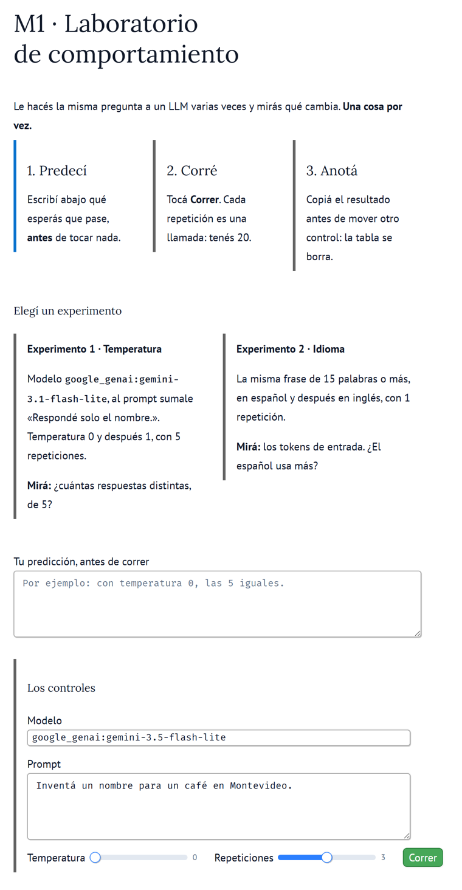

# M1 · Laboratorio de comportamiento

| Módulo | Clase | En clase | IA permitida |
|---|---|---|---|
| M1 | 1 | 15 min | A1 |

**Entregás:** diagnóstico del cuaderno, fila de 1 experimento.

[](https://colab.research.google.com/github/JuanFKurucz/ucu-la/blob/main/notebooks/m1_laboratorio.ipynb) Abrir el cuaderno en Colab (para quien no tiene el entorno instalado).


## Objetivo

- Lo del cuaderno de Python (`m1_python_de_cero.ipynb`), con un **LLM real**: **una** variable por vez, como en ML.
- Separar lo que viste de por qué creés que pasó.

## Punto de partida

- **Lab:** `labs/m1_comportamiento.py`, en **marimo** (un cuaderno que se actualiza solo).
- **Temperatura:** solo cambia algo con `google_genai:gemini-3.1-flash-lite` (o `ollama:qwen3.5:2b`, si lo tenés). Gemini 3.5 Flash-Lite (el de `config.toml`) la ignora: por eso el experimento 1 cambia el modelo.
- **Decidís:** experimento y predicción, antes de correr.
- **¿Sin el entorno instalado?** Lo mismo en Colab: el botón «Open in Colab» de arriba.

## Arranque

1. En la carpeta del proyecto:

    ```bash
    uv run marimo edit labs/m1_comportamiento.py
    ```

2. **Qué deberías ver:** los tres pasos (predecí, corré, anotá), los dos experimentos, «Tu predicción» y los controles: «Modelo», «Prompt», Temperatura, Repeticiones y «Correr». Escribí tu predicción y tocá «Correr».

    

**Primer control · 10–15 min:** tabla con 3 respuestas y sus tokens; «llamadas usadas en esta corrida»: 3.

- **Saldo:** una llamada por repetición. Tope: 20 por persona (lo pone el lab). Experimento 1: 10; experimento 2: 2.

<details markdown="1"><summary>¿Sale un error?</summary>

- **No abre el lab:** pegá en el navegador la dirección `http://localhost:…` que muestra la terminal.
- **«503»:** Gemini está saturado, no es tu código. Esperá un minuto o hacé el experimento 2.
- **Otro mensaje:** buscalo, tal como sale, en guía 1, «Si te trabás» (en el aula virtual): cada fila empieza con el texto que ves.

</details>

## En clase

Elegí **uno**:

| # | Qué cambiás | Qué mirás |
|---|---|---|
| 1 | En «Modelo», `google_genai:gemini-3.1-flash-lite`. Al prompt sumale «Respondé solo el nombre.». Temperatura 0 y después 1, 5 repeticiones cada una | ¿Cuántas distintas, de 5? |
| 2 | La misma frase (15+ palabras) en español y en inglés, 1 repetición | ¿Tokens de entrada? ¿El español usa más? |

1. **Predecí** por escrito, en «Tu predicción» del lab.
2. **Corré** y anotá antes de mover otro control (la tabla se borra).
3. **Cambiá una sola cosa** y corré de nuevo.
4. **Explicá** con el cuaderno: ejercicios 7 y 9 (temperatura) u 8 (tokens). Con 0 y distintas no es error: en una API, 0 no garantiza lo mismo.

## Controles

- Mismo prompt en las dos condiciones (salvo el idioma).
- 5 repeticiones al medir variación.
- La explicación no contradice lo que viste.

## Resultado probado

Una fila: **predicción · resultado · explicación**. Ej.: «Predije 5 iguales · salieron 3 distintas · Gemini 3.5 Flash-Lite ignora la temperatura».

## Evidencia

En `evidencia/m1.md` (sin nota; plantilla):

- La fila del experimento y una frase «Esto **no** demuestra que…».
- Tu **diagnóstico** del cuaderno: la última celda lo arma sola con lo que te salió.

## Para casa

- Terminá el cuaderno (el ejercicio 10, JSON, se usa el miércoles).
- Una fila más: un **dato al principio, medio o final** de 2–3 páginas («¿lo encuentra?»), o **algo que no existe**, con y sin «si no sabés, decilo» («¿inventa?»).

## Microdefensa

- ¿Qué contradijo tu predicción? ¿Qué lo explicaría?
- Confianza del 1 al 4 (glosario).
