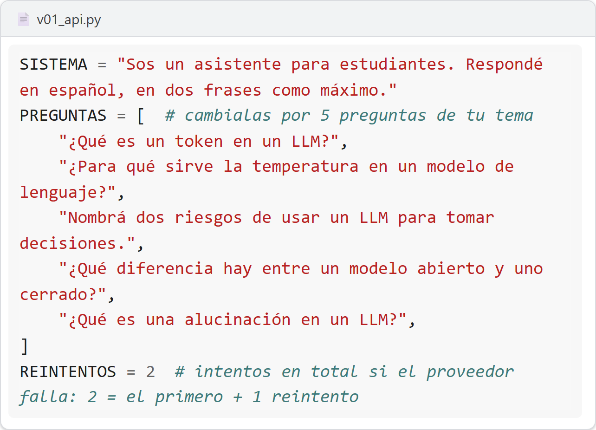

# M3 · v0.1 Tu primer programa con un LLM

| Módulo | Clase | En clase | IA permitida |
|---|---|---|---|
| M3 | 2 | 25 min | A2 |

**Entregás:** v0.1 en el repo, tabla de las dos configuraciones, decisión de configuración, estimación de costo.

[](https://colab.research.google.com/github/JuanFKurucz/ucu-la/blob/main/notebooks/m3_v01_api.ipynb) Abrir el cuaderno en Colab (para quien no tiene el entorno instalado).


## Objetivo

- Un programa que pregunta sobre **tu tema**, guarda respuesta, tokens y tiempo, y no se cae.
- Elegís configuración y estimás costo. Es la **v0.1**.

## Punto de partida

- **Archivo:** `v01_api.py`. **Perillas:** `SISTEMA`, `PREGUNTAS`, `REINTENTOS`.
- **Registro:** `logs/v01.jsonl`, un renglón por pregunta.
- **¿Sin el entorno instalado?** Lo mismo en Colab: el botón «Open in Colab» de arriba.

## Arranque

1. Corré:

    ```bash
    uv run python v01_api.py
    ```

2. **Qué deberías ver:** cada pregunta con `>`, la respuesta de a poco, `tokens={…} latencia=…s` y al final `Error controlado: …` (un error a propósito: el programa no se cae).

**Primer control · 10–15 min:** el log tiene modelo, tokens y latencia.

<details markdown="1"><summary>¿Sale un error?</summary>

- **«config.toml está mal escrito»:** los textos van entre comillas rectas (`model = "google_genai:gemini-3.5-flash-lite"`) y los decimales con punto (`temperature = 0.5`).
- **No aparece `logs/v01.jsonl`:** se crea con la primera respuesta. Si no está, el programa se cortó antes: leé el error.
- **«429: se terminó la cuota del día…»:** reintentar no sirve. Esperá a que se renueve o cambiá de modelo en `config.toml`.
- **Otro mensaje:** buscalo, tal como sale, en guía 2, «Si te trabás» (en el aula virtual): cada fila empieza con el texto que ves.

</details>

## En clase

1. **Tus preguntas:** cambiá las 5 `PREGUNTAS` por preguntas de tu tema.

    

2. **Predecí** y variá **una** cosa: `SISTEMA` corto vs con reglas, o dos modelos (`model` en `config.toml`, por ejemplo `google_genai:gemini-3.1-flash-lite`).
3. **Borrá** `logs/v01.jsonl` y corré una vez con cada configuración. Quedan 10 respuestas y 2 errores.
4. **Compará:** guardá este código como `tabla.py` en la carpeta del proyecto y corré `uv run python tabla.py`. Si variaste el `SISTEMA`, cambiá `"modelo"` por `"sistema"`:

    ```python
    import pandas as pd
    log = pd.read_json("logs/v01.jsonl", lines=True)
    log = log[log["error"].isna()]  # sin los errores a propósito
    log["entrada"] = log["uso"].str.get("input_tokens")  # para el costo (Para casa)
    log["salida"] = log["uso"].str.get("output_tokens")
    print(log.groupby("modelo")[["entrada", "salida", "latencia_s"]].mean().round(1))
    print(log.groupby("modelo")[["latencia_s"]].median())  # la 1.ª llamada tarda más
    ```

    **Qué deberías ver:** promedios por configuración y, abajo, la mediana de latencia (esa va en la tabla).

5. **Decidí** y dejala puesta.
6. *Commit* («v0.1: …») y *Push*.

## Controles

- `.env` **no** aparece en los cambios.
- El log tiene las 10 preguntas y los errores.
- Las dos configuraciones, con las mismas 5 preguntas.

## Resultado probado

| Configuración | Tokens de salida (prom.) | Latencia (mediana) | Respuestas buenas |
|---|---|---|---|
| A: … | | | /5 |
| B: … | | | /5 |

## Evidencia

En `evidencia/v0.1.md`, entrega de avance 1 (hasta el mar 3/11, 23:59): tabla, configuración y porqué, qué error se reintenta y el costo del «Para casa». El docente comenta en un *issue* «Entrega de avance 1» el fin de semana.

## Para casa

**Costo mensual** a 1000 preguntas por día, con tus tokens promedio y el precio oficial con fecha ([Gemini](https://ai.google.dev/gemini-api/docs/pricing), [OpenAI](https://developers.openai.com/api/docs/pricing); *Paid tier*):

costo por pregunta = tokens de entrada × precio de entrada / 1.000.000 + tokens de salida × precio de salida / 1.000.000

costo por mes = costo por pregunta × 1000 × 30 (la misma cuenta que hace v1.0 en la clase 7)

En Python: `1_000_000`, y `print(f"{costo:.7f}")` para ver los decimales.

## Microdefensa

- ¿Qué error vale reintentar y cuál no?
- Confianza del 1 al 4.
