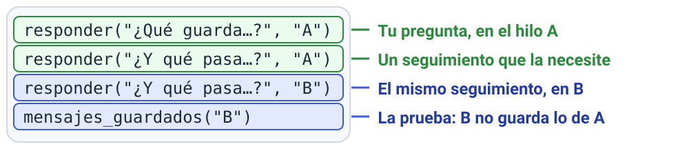

# M5 · v0.3 Framework y memoria

| Módulo | Clase | En clase | IA permitida |
|---|---|---|---|
| M5 | 4 | 85 min | como copiloto: escribe con vos y vos lo explicás (A2) |

**Entregás:** v0.3 en el repo, medición antes/después, test de hilos, nota de decisión.

[](https://colab.research.google.com/github/JuanFKurucz/ucu-la/blob/main/notebooks/m5_v03_memoria.ipynb) Abrir el cuaderno en Colab (para quien no tiene el entorno instalado).


## Objetivo

- Tu RAG, armado con LangChain, **sin que empeore**.
- **Lo nuevo:** entiende «¿y por región?» después de «¿cómo se calcula el churn?» y conversa con memoria por hilo, sin mezclar clientes y con un límite. Es la **v0.3**.

## Punto de partida

- **Tu repo**, con `v02_rag.py` y `medir.py` de M4. Creás `v03_memoria.py` en la misma carpeta.
- **El contrato:** `responder(pregunta, hilo)` devuelve lo de v0.2 y recuerda lo dicho en el mismo `hilo`.
- **¿Sin el entorno?** Colab: el botón «Open in Colab» de arriba.
- **Con tu asistente de IA:** pegale cada paso y pedile «explicame cada renglón». Cada renglón lo tenés que poder explicar.

El hilo es como la clave de un cliente en una tabla de ventas: cada mensaje se guarda con su clave, y el modelo ve solo los de la misma (un `WHERE hilo = 'A'`).

## Arranque

1. **El mismo RAG, con LangChain.** `create_agent` arma el ciclo; `con_contexto` corre antes de cada llamada y suma lo que trajo tu `buscar`; `InMemorySaver` guarda cada hilo.

    ```python
    import time, uuid
    from langchain.agents import create_agent
    from langchain.agents.middleware import ModelRequest, dynamic_prompt
    from langgraph.checkpoint.memory import InMemorySaver
    from llm import cargar_modelo
    from v02_rag import SISTEMA, buscar  # tu búsqueda de M4, sin cambios
    fuentes = []  # los documentos de la última búsqueda
    @dynamic_prompt  # la @ le entrega la función a LangChain: la corre antes de cada llamada al modelo
    def con_contexto(pedido: ModelRequest) -> str:
       hits = buscar(pedido.messages[-1].text)  # busca solo con el último mensaje
       fuentes.clear()  # las de la pregunta anterior, fuera
       fuentes.extend(dict.fromkeys(h["doc"] for h in hits))  # cada documento una vez, como un DISTINCT
       contexto = "\n\n".join(f"[{h['doc']}]\n{h['texto']}" for h in hits)
       return f"{SISTEMA}\n\nContexto:\n{contexto}"
    asistente = create_agent(cargar_modelo(), tools=[], middleware=[con_contexto], checkpointer=InMemorySaver())
    ```

2. **Responder dentro de un hilo**, y una demo que solo corre desde la terminal (no cuando `medir.py` importa el archivo):

    ```python
    def responder(pregunta: str, hilo: str = "") -> dict:  # sin hilo, una conversación nueva
       inicio, config = time.perf_counter(), {"configurable": {"thread_id": hilo or uuid.uuid4().hex}}
       ultimo = asistente.invoke({"messages": [("user", pregunta)]}, config)["messages"][-1]
       return {"respuesta": ultimo.text, "fuentes": list(fuentes), "latencia_s": round(time.perf_counter() - inicio, 2),
               "tokens_entrada": ultimo.usage_metadata["input_tokens"], "tokens_salida": ultimo.usage_metadata["output_tokens"]}
    def mensajes_guardados(hilo):  # cuántos mensajes guardó ese hilo
       return len(asistente.get_state({"configurable": {"thread_id": hilo}}).values.get("messages", []))
    if __name__ == "__main__":
       print(responder("¿Qué guarda un checkpointer en LangGraph?", "A")["respuesta"])
       print(responder("¿Y qué pasa con eso si se reinicia el proceso?", "A")["respuesta"])
       print(responder("¿Y qué pasa con eso si se reinicia el proceso?", "B")["respuesta"])
       print("hilo A:", mensajes_guardados("A"), "· hilo B:", mensajes_guardados("B"))
    ```

    Corré `uv run python v03_memoria.py`. **Qué deberías ver:** tres respuestas y `hilo A: 4 · hilo B: 2`. Las respuestas varían; la prueba de memoria es la cuenta (cada turno guarda tu pregunta y la respuesta).

**Primer control · 10–15 min:** «hilo A: 4 · hilo B: 2».

## En clase

1. **Chequeo (5 min):** en `medir.py`, cambiá `v02_rag` por `v03_memoria` (en los dos lugares: el `import` y la llamada) y corré `uv run python medir.py`. **Qué deberías ver:** el mismo hit que en M4 (con la suite de ejemplo, 10 de 11).
2. **Tu conversación:** en la demo, poné una pregunta tuya y un seguimiento que la **necesite**, como «¿y por región?» (en `"B"`, el mismo seguimiento). Debajo del de `"A"`, sumá `print(fuentes)` (con 4 espacios). **Mirá:** ¿trajo tus documentos? Busca solo con «¿y por región?».

    

3. **Arreglá el seguimiento:** el modelo lo reescribe antes de buscar. Pegá esto arriba de `@dynamic_prompt`:

    ```python
    from langchain_core.output_parsers import StrOutputParser
    from langchain_core.prompts import ChatPromptTemplate
    reformular = ChatPromptTemplate.from_messages([
       ("system", "Reescribí la última pregunta para que se entienda sola. Devolvé solo la pregunta."),
       ("human", "Charla:\n{charla}\n\nÚltima pregunta: {pregunta}"),
    ]) | cargar_modelo() | StrOutputParser()  # LCEL: cada | le pasa su salida al siguiente
    def pregunta_sola(mensajes):  # la primera va tal cual; un seguimiento, reescrito con la charla
       if len(mensajes) == 1:
           return mensajes[0].text
       charla = "\n".join(f"{m.type}: {m.text}" for m in mensajes[:-1])
       nueva = reformular.invoke({"charla": charla, "pregunta": mensajes[-1].text})
       print("   buscando con:", nueva)
       return nueva
    ```

    En `con_contexto`, cambiá `buscar(pedido.messages[-1].text)` por `buscar(pregunta_sola(pedido.messages))`. **Qué deberías ver:** `buscando con: ¿Cómo se calcula el churn por región?` y tus documentos en `fuentes`. Como un filtro de Power BI que pasa a la página siguiente.

4. **Aislamiento:** sumá al final de la demo, con 4 espacios:

    ```python
       print(responder("otra pregunta de tu tema", "B")["respuesta"])
       print("hilo A:", mensajes_guardados("A"), "· hilo B:", mensajes_guardados("B"))
    ```

    **Qué deberías ver:** `hilo A: 4 · hilo B: 4`. B creció; A no se enteró.

5. **Una charla larga:** sumá al final, con cinco preguntas tuyas encadenadas:

    ```python
       for i, p in enumerate(["tu pregunta", "un seguimiento", "otro", "otro más", "y otro"], 1):
           print("turno", i, "· tokens de entrada:", responder(p, "C")["tokens_entrada"])
       print("hilo C:", mensajes_guardados("C"))
    ```

    **Qué deberías ver:** los tokens suben turno a turno (cada pedido reenvía toda la charla) y `hilo C: 10`.

6. **Memoria con límite:** el modelo ve solo lo último, como un `TOP 4` por fecha. Pegá esto arriba de `asistente = create_agent(...)`:

    ```python
    from langchain.agents.middleware import wrap_model_call
    from langchain_core.messages import trim_messages
    @wrap_model_call  # en cada llamada, el modelo ve el último intercambio y tu pregunta; el hilo guarda todo
    def ultimos(pedido, llamar):
       return llamar(pedido.override(messages=trim_messages(
           pedido.messages, strategy="last", token_counter=len, max_tokens=4, start_on="human")))
    ```

    En `create_agent`, cambiá `middleware=[con_contexto]` por `middleware=[ultimos, con_contexto]`. **Qué deberías ver:** desde el turno 2, tokens parejos; el hilo sigue en `hilo C: 10`. Ahorrás tokens y perdés memoria.

7. *Commit* («v0.3: …») y *Push*.

## Controles

- Misma suite, modelo y perillas que en M4.
- El seguimiento busca con la pregunta reescrita.
- B no ve nada de A.
- Con límite, tokens parejos; el hilo guarda todo.

## Resultado probado

Pasos 3 a 6: la pregunta reescrita, el test de hilos y los tokens sin y con límite.

| Versión | Hit | NO ENCONTRADO bien | Correctas (tu juicio) | Latencia (mediana) |
|---|---|---|---|---|
| v0.2 | | | | |
| v0.3 | | | | |

## Evidencia

En `evidencia/v0.3.md`, entrega de avance 3 (hasta el mié 18/11, 23:59): tabla, test de hilos, diferencias y una **nota de decisión** de 3 líneas.

## Para casa

- Con tu tema, ¿alcanzan 4 mensajes? Probá 2 y 8 en `max_tokens` y anotá qué olvida cada uno.
- Reformular suma una llamada por seguimiento: ¿cuánto subió la latencia?
- ¿Últimos mensajes (`trim_messages`) o resumen (`SummarizationMiddleware`)? Decidí y justificá, sin programarlo.

## Microdefensa

- ¿Qué ya no podrías explicar sin leer el código de LangChain?
- Confianza del 1 al 4.
