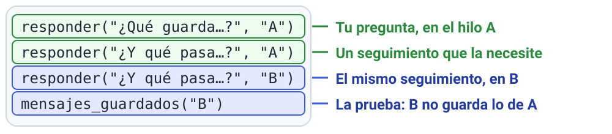

# M5 · v0.3 Framework y memoria

| Módulo | Clase | En clase | IA permitida |
|---|---|---|---|
| M5 | 4 | 100 min | A2 |

**Entregás:** v0.3 en el repo, suite antes/después, test de hilos, nota de decisión.

[](https://colab.research.google.com/github/JuanFKurucz/ucu-la/blob/main/notebooks/m5_v03_memoria.ipynb) Abrir el cuaderno en Colab (para quien no tiene el entorno instalado).


## Objetivo

- Tu RAG en LangChain **sin que empeore** (lo prueba la suite).
- Memoria por conversación, sin mezclar hilos. Es la **v0.3**.

## Punto de partida

- **Archivos:** `v03_memoria.py` (mismo RAG, en LangChain, con memoria) y `v02_rag.py`. Mismas perillas.
- **¿Sin el entorno instalado?** Lo mismo en Colab: el botón «Open in Colab» de arriba.

## Arranque

1. Corré:

    ```bash
    uv run python v03_memoria.py
    ```

2. **Qué deberías ver:** tres respuestas y `Mensajes guardados → hilo A: 4 · hilo B: 2`. Las respuestas varían; la prueba de memoria es la cuenta.

**Primer control · 10–15 min:** «hilo A: 4 · hilo B: 2».

## En clase

1. **Predecí:** de `v02` a `v03`, ¿la suite cambia?
2. **Antes y después:**

    ```bash
    uv run python suite.py v02_rag:con_rag datos/mi_suite.jsonl --tag v02
    uv run python suite.py v03_memoria:con_rag datos/mi_suite.jsonl --tag v03
    ```

    **Qué deberías ver:** el `hit` suele dar igual (ejemplo: 10/11 en las dos).

3. **Cada diferencia:** mirá `correcta` en los dos CSV. Para ver qué fuentes cambiaron, guardá este código como `compara.py` en la carpeta del proyecto y corré `uv run python compara.py`:

    ```python
    import pandas as pd
    leer = dict(sep=None, engine="python", encoding="utf-8-sig", encoding_errors="replace", keep_default_na=False)  # «;» y ANSI de Excel
    a = pd.read_csv("logs/suite-v02.csv", **leer)
    b = pd.read_csv("logs/suite-v03.csv", **leer)
    c = a.merge(b, on="id", suffixes=("_v02", "_v03"))
    print(c[c["fuentes_v02"] != c["fuentes_v03"]][["id", "fuentes_v02", "fuentes_v03"]])
    ```

4. **Tu conversación:** al final de `v03_memoria.py`, cambiá el texto de los `preguntar(…)` por una pregunta tuya y un seguimiento que la **necesite** (en `"B"`, el mismo seguimiento).

    

5. **Aislamiento:** sumá al final, con 4 espacios de sangría, y corré:

    ```python
       print(preguntar("otra pregunta de tu tema", "B"))
       print(mensajes_guardados("A"), mensajes_guardados("B"))
    ```

    **Qué deberías ver:** con la demo original, `4 4`.

6. *Commit* («v0.3: …») y *Push*.

## Controles

- Misma suite, modelo y perillas.
- Pregunta y seguimiento en el mismo hilo.
- B no ve nada de A.

## Resultado probado

Tu test de hilos (la demo con tus preguntas y el paso 5). Sin gastar: `uv run pytest tests/test_memoria.py` (`3 passed`).

| Versión | Hit | Abstención correcta | Correctas | Latencia (mediana) |
|---|---|---|---|---|
| v0.2 | | | | |
| v0.3 | | | | |

## Evidencia

En `evidencia/v0.3.md`, entrega de avance 3 (hasta el mar 17/11, 23:59): tabla, test de hilos, diferencias y una **nota de decisión** de 3 líneas.

## Para casa

- Alargá una conversación hasta 10 turnos o hasta que moleste: ¿cuántos aguantó?
- ¿Últimos mensajes (`trim_messages`) o resumen (`SummarizationMiddleware`)? Decidí y justificá, sin programarlo.

## Microdefensa

- ¿Qué ya no podrías explicar sin leer el código de LangChain?
- Confianza del 1 al 4.
