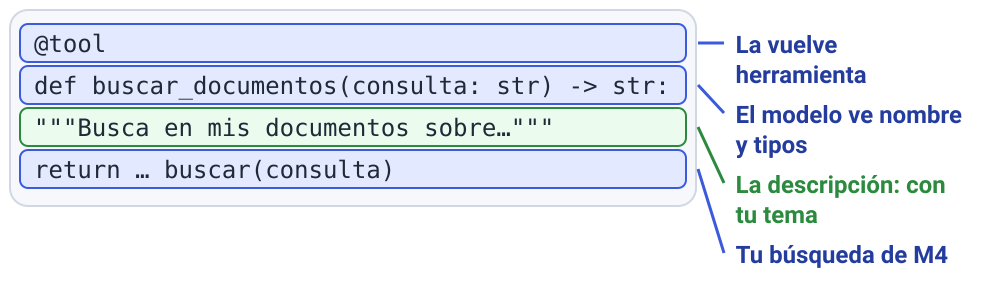

# M6 · v0.4 Agente con herramientas

| Módulo | Clase | En clase | IA permitida |
|---|---|---|---|
| M6 | 5 | 105 min | A2 |

**Entregás:** v0.4 en el repo, suite de selección propia, 2 corridas, fallo manejado.

[](https://colab.research.google.com/github/JuanFKurucz/ucu-la/blob/main/notebooks/m6_v04_agente.ipynb) Abrir el cuaderno en Colab (para quien no tiene el entorno instalado).


## Objetivo

- Que tu asistente **elija bien**: documentos, internet o calculadora.
- Que ante un fallo **lo diga en vez de inventar**. Es la **v0.4** (requisito 2).

## Punto de partida

- **Archivos:** `herramientas.py` y `v04_agente.py`.
- **Decidís:** descripciones, `SISTEMA`, límites y `web` en `config.toml`.
- **En `herramientas.py`:** tus `CHUNK`, `OVERLAP` y `K` de M4 (de fábrica, acá `K` viene en 3 y en `v02_rag.py`, en 4); el agente ve los primeros 600 caracteres de cada fragmento.
- **Datos:** `datos/m6_seleccion.jsonl`, 12 preguntas con su herramienta esperada.
- **¿Algo nuevo?** Guía de la clase 5 (en el aula virtual), secciones 3 a 5.
- **¿Sin el entorno instalado?** Lo mismo en Colab: el botón «Open in Colab» de arriba.

## Arranque

1. `uv run python herramientas.py`. **Qué deberías ver:** `25`, un fragmento, un resultado web grabado y lo que el modelo ve de cada herramienta.
2. Corré:

    ```bash
    uv run python v04_agente.py
    ```

    **Qué deberías ver:** `herramientas=[…]`, `llamadas=2` y la respuesta, por pregunta.

**Primer control · 10–15 min:** ves qué herramienta pidió en cada pregunta.

## En clase

1. **Tu tema:** la descripción de `buscar_documentos` y el `SISTEMA`.

    

2. **Tu suite:** `datos/mi_seleccion.jsonl`, unas 10 preguntas.
    Al menos una de cada `tipo`: `corpus` (tus documentos), `web`, `calculo`, `ninguna` (un saludo) y `combinada`.
    Ninguna es `[]`; combinada, con las dos:

    ```json
    {"id": 9, "tipo": "ninguna", "pregunta": "Hola", "esperado": "Saludo", "herramientas": []}
    {"id": 10, "tipo": "combinada", "pregunta": "¿Cuántas cuotas dice el reglamento? Multiplicá por 12.", "esperado": "…", "herramientas": ["buscar_documentos", "calcular"]}
    ```

3. **Predecí** en cuáles se confunde.
4. **Medí** con `web = "grabada"` (mide la elección, no la respuesta):

    ```bash
    uv run python suite.py v04_agente:responder datos/mi_seleccion.jsonl --tag v04-a
    ```

    **Qué deberías ver:** `v04-a: selección 7/10 · llamadas/consulta 2.4 · …`. En el CSV, `herramientas_esperadas` vs `herramientas` es tu matriz.

5. **UNA cosa** (descripción, `SISTEMA`, límite o modelo) y `--tag v04-b`.
6. **Fallá a propósito:** `web = "caida"` y `uv run python v04_agente.py "¿Cuál es la última versión de LangGraph?"`. ¿Avisa o inventa? ¿Pidió `buscar_web`? Volvé a `web = "real"`.
7. *Commit* («v0.4: …») y *Push*.

## Controles

- Misma suite y modo de web en las dos corridas.
- Ninguna pregunta pasa de `MAX_LLAMADAS_MODELO` (columna `llamadas`).
- Ninguna herramienta escribe ni borra.

## Resultado probado

| Corrida | Selección correcta | Llamadas por consulta | Qué cambié |
|---|---|---|---|
| v04-a | | | (base) |
| v04-b | | | |

## Evidencia

En `evidencia/v0.4.md`, entrega de avance 3 (hasta el mar 17/11, 23:59): tabla, **matriz**, tu cambio y la web caída. Declará la web grabada.

## Para casa

- 3 preguntas **ambiguas** (`"tipo": "ambigua"`), con la herramienta que elegirías vos.
- Correlas juntas con `v04_agente.py`: ¿eligió bien?

## Microdefensa

- Una elección equivocada: ¿descripción, `SISTEMA`, pregunta o modelo?
- Confianza del 1 al 4.
