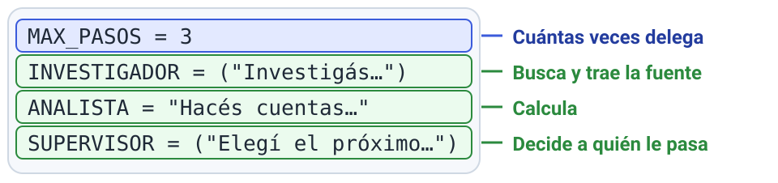

# M7 · v0.5 Equipo de agentes con aprobación humana

| Unidad | Clase | En clase | IA permitida |
|---|---|---|---|
| M7 | 6 | 110 min | A2 |

**Entregás:** v0.5 en el repo, diagrama del grafo, prueba de rechazo, tabla agente único vs equipo.

[](https://colab.research.google.com/github/JuanFKurucz/ucu-la/blob/main/notebooks/m7_v05_equipo.ipynb) Abrir el cuaderno en Colab (para quien no tiene el entorno instalado).


## Objetivo

- Tu asistente como **equipo** (supervisor, investigador, analista, redactor), con **una persona que aprueba**.
- Medir si el equipo vale lo que cuesta frente a `v0.4`. Es la **v0.5** (requisito 3).

## Punto de partida

- **Archivo:** `v05_equipo.py` (usa tus herramientas de M6).
- **Decidís:** `MAX_PASOS`, `INVESTIGADOR`, `ANALISTA` y `SUPERVISOR`.
- **¿Algo nuevo?** Guía de la clase 6 (en el aula virtual) y guía de la clase 7 (en el aula virtual).
- **¿Sin el entorno instalado?** Lo mismo en Colab, sin archivos: `cuadernos/m7_v05_equipo.ipynb`.

## Arranque

1. Con `web = "grabada"` en `config.toml`:

    ```bash
    uv run python v05_equipo.py
    ```

2. **Qué deberías ver:** el grafo en texto (`---`, `config:`, `graph TD;`), el borrador y «Con aprobación…» / «Con rechazo…».
3. Pegá el dibujo (del primer `---` a la última `classDef`) en [mermaid.live](https://mermaid.live).

**Primer control · 10–15 min:** grafo en mermaid.live, borrador y dos respuestas.

## En clase

**Clase 6 · el equipo**

1. **Predecí:** ¿dónde gana el equipo? ¿Cuántas llamadas más?
2. **Tu tema:** en `INVESTIGADOR`, tu tema; en `pregunta = …`, una pregunta que necesite investigar **y** calcular.

    

3. **El recorrido:** debajo de la línea que imprime «Borrador:», con 4 espacios, `print(pausa.get("notas"))`. Quién actuó: `uv run python -m ejemplos.clase7 equipo "tu pregunta"`.

**Clase 7 · aprobar y comparar**

4. **Aprobar y rechazar** (`True` / `False` en `correr`): con rechazo **no** hay respuesta final.
5. **Comparar con v0.4**, misma suite y web:

    ```bash
    uv run python suite.py v04_agente:responder datos/mi_seleccion.jsonl --tag v04
    uv run python suite.py v05_equipo:responder datos/mi_seleccion.jsonl --tag v05
    ```

    **Qué deberías ver:** una línea por versión, con `selección`, `llamadas/consulta` y `latencia mediana`. El equipo hizo de 2,6 a 4,6 veces más llamadas.

6. *Commit* («v0.5: …») y *Push*.

## Controles

- El estado sigue al retomar: al final, con la sangría del paso 3, `print(grafo.get_state({"configurable": {"thread_id": "demo-aprueba"}}).values.keys())` muestra `pregunta`, `notas`, `borrador` y `respuesta_final`.
- Misma suite, modelo y web en la comparación.

## Resultado probado

| Versión | Selección correcta | Respuestas correctas (tu juicio) | Llamadas por consulta | Latencia (mediana) |
|---|---|---|---|---|
| v0.4 · agente solo | | | | |
| v0.5 · equipo | | | | |

## Evidencia

En `evidencia/v0.5.md` ([plantilla](../plantillas/evidencia-version.md)), después al [registro de evaluación](../plantillas/registro-evaluacion.md): diagrama, aprobar y rechazar, tabla y **tu decisión** (si gana el agente solo, también vale).

## Para casa

- `MAX_PASOS` en 1 y en 5, con `--tag pasos1` y `--tag pasos5`. Con 3 (de fábrica) es la `v05` del paso 5.
- ¿Selección, llamadas, latencia? Al terminar, volvé a 3.

## Microdefensa

- ¿Qué pasa del investigador al redactor, y por qué no toda la conversación?
- Confianza del 1 al 4.
