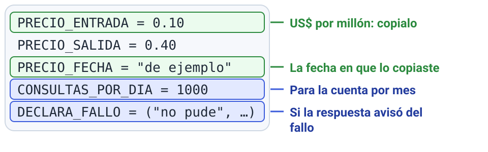

# M8 · v1.0 ¿Lo liberarías?

| Módulo | Clase | En clase | IA permitida |
|---|---|---|---|
| M8 | 7 | 25 min | A3 |

**Entregás:** v1.0 en el repo, extracto de la traza en la evidencia, costo por consulta y por mes, test del guardrail, decisión go/no-go.

[](https://colab.research.google.com/github/JuanFKurucz/ucu-la/blob/main/notebooks/m8_v10_produccion.ipynb) Abrir el cuaderno en Colab (para quien no tiene el entorno instalado).


## Objetivo

- Evidencia para decidir si gente real podría usarlo: **traza**, **costo**, **protección con test** y una práctica de producción.
- Es la **v1.0** (requisito 4).

## Punto de partida

- **Archivo:** `v10_produccion.py`: v0.4 + traza, costo, tapado de emails y fallo seguro.
- **Tests sin gastar:** `tests/test_produccion.py` y `tests/test_pii.py`.
- **Decidís:** tu peor fallo y su test, tu práctica, `PRECIO_ENTRADA`, `PRECIO_SALIDA`, `PRECIO_FECHA` y `CONSULTAS_POR_DIA`.
- **¿Algo nuevo?** Guía de la clase 7 (en el aula virtual), secciones 3 a 7.
- **¿Sin el entorno instalado?** Lo mismo en Colab: el botón «Open in Colab» de arriba.

## Arranque

1. Corré:

    ```bash
    uv run pytest tests/test_produccion.py
    ```

    **Qué deberías ver:** `4 passed`.

2. Con `web = "caida"`: `uv run python v10_produccion.py`. **Qué deberías ver:** respuesta, herramientas, tokens, costo y la ruta de la traza (un «OJO» por precios de ejemplo es normal).

**Primer control · 10–15 min:** en `logs/traza.jsonl`, después del último `"tipo": "consulta"`, los pasos: `"tipo": "modelo"` con tokens en `uso`, `"tipo": "herramienta"` con su `nombre`.

## En clase

1. **Operá:** `web = "grabada"` y tu suite:

    ```bash
    uv run python suite.py v10_produccion:responder datos/mi_seleccion.jsonl --tag v10
    ```

2. **Costo:** una consulta y un mes a 1000 por día: `uv run python v10_produccion.py "pregunta 1" "pregunta 2" "pregunta 3"`.

    

3. **Tu peor fallo:** copiá el primer test comentado de `tests/test_produccion.py` (borrá `#` **y** espacio) y adaptalo. **Qué deberías ver:** `5 passed`. ¿`failed`? El guardrail no lo atrapa: usá el segundo ejemplo, que muestra ese límite.
4. **Tu práctica de producción** (una): trazas, costos, guardrail, caché o evaluación continua.
    Caché en tres líneas, arriba de `v10_produccion.py`: `from langchain_core.caches import InMemoryCache`, `from langchain_core.globals import set_llm_cache` y `set_llm_cache(InMemoryCache())`.
    Vive mientras corre el programa: repetí una pregunta y medí `latencia_s`.

5. **Go / no-go** en media página: «**No-go por ahora.** Suite: x/n. Costo: US$ … por consulta y por mes (precio del dd/mm). Test: pasa. Sigue fallando: … Probaría: …».
6. *Commit* («v1.0: …») y *Push*.

## Controles

- La suite no empeora (o explicás por qué).
- `uv run pytest` sin `failed`.
- La traza de la evidencia no tiene claves ni datos personales.

## Resultado probado

`v1.0` en el repo y el go / no-go del paso 5.

## Evidencia

En `evidencia/v1.0.md`, después al registro de evaluación: traza, costo con fecha, test y decisión.

## Para casa

- La **lista de entrega** de la guía de la clase 8 (en el aula virtual).
- Los 4 entregables hasta el **domingo 22/11, 23:59**.

## Microdefensa

- ¿Qué te impide liberarlo hoy? ¿Qué prueba lo resolvería?
- Confianza del 1 al 4.
